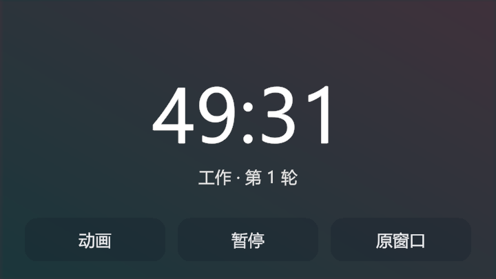

# Lo-Fi 学习小窗

给《放松时光：与你共享 Lo-Fi 故事》（Chill with You: Lo-Fi Story）加一个常驻置顶的番茄钟小窗，让音乐和计时陪你学习，并通过静态背景减少持续绘制房间的开销。

**本项目基于并借鉴开源项目 [iGPU Savior](https://github.com/Small-tailqwq/iGPUSaviorMod)，原作者为 [Small-tailqwq](https://github.com/Small-tailqwq)。这是独立维护的衍生改进版，保留原项目的 MIT 许可证及版权声明，详见 [致谢与来源](CREDITS.md)。**

[下载最新发布包](../../releases/latest) · [安装说明](docs/INSTALL.md) · [完整使用说明](docs/LEARNING_WINDOW.md) · [验证记录](docs/VALIDATION.md)



*隔离测试背景下的界面预览；实际游戏使用房间背景和游戏字体。*

## 适合怎么用

在游戏原窗口里选好音乐、设置并启动番茄钟，再切换到学习小窗。一边看资料、做题，一边查看剩余时间；需要操作故事、音乐或笔记时，随时返回原窗口。

- **置顶番茄钟**：显示原游戏的剩余时间和轮次，可直接暂停／继续。
- **默认静态背景**：保留房间截图，暂停房间相机持续绘制，音乐和计时继续运行；也可切换低帧率动画。
- **简洁的小窗**：去掉顶部说明文字，三个按钮使用相同颜色的半透明圆角背景；顶部可拖动，边缘可缩放。
- **记住窗口**：保存小窗位置和尺寸，返回原窗口时恢复先前的窗口状态。
- **原项目功能**：保留土豆模式、镜像、竖屏、MOD 设置及笔记导出等功能。

本次改进还处理了导出线程调度、镜像资源清理、窗口归属检查、设置页重复注册与失败恢复等问题。修复范围和未完成的验证见 [验证记录](docs/VALIDATION.md)。

## 安装，三步开始

适用环境：**Windows x64、游戏本体、BepInEx 5.x**。发布包只包含插件及辅助文件，不包含游戏和 BepInEx 加载器。

1. 从 [Releases](../../releases/latest) 下载插件 ZIP 并解压。首次使用 MOD 时，先按 [安装说明](docs/INSTALL.md) 单独安装 **Windows x64 版 BepInEx 5**；不要用 BepInEx 6。
2. 完全退出游戏，双击解压目录中的 **`安装.cmd`**。脚本会尝试找到 Steam 游戏目录，备份旧 DLL 和配置后安装；找不到时按 [说明](docs/INSTALL.md#方法二powershell-安装脚本) 指定目录。也可手动将 `BepInEx/plugins/iGPU Savior.dll` 复制到游戏目录同名位置；整个 `plugins` 目录只保留一份本插件。
3. 通过 Steam 启动游戏。完成教程、进入普通房间后，默认自动显示学习小窗；未自动进入时按 **F3**。番茄钟尚未开始时，点击“原窗口”设置并启动，再按 F3 返回。

需要回退时，退出游戏后双击 **`卸载.cmd`**，恢复安装前的 DLL；原来没有安装过插件时移走本插件。配置与存档保留。详细命令和手动方法见 [安装说明](docs/INSTALL.md)。

> 如果已安装原版 iGPU Savior，请用本版替换原插件。两者沿用相同的插件标识和配置文件，不应同时安装。

## 日常操作

| 操作 | 效果 |
|---|---|
| **F3** | 在学习小窗和原窗口之间切换 |
| **暂停／继续** | 控制原游戏番茄钟 |
| **动画／静态** | 切换到按钮文字所示的画面模式 |
| **原窗口** | 恢复完整游戏界面和原窗口状态 |
| 拖动顶部空白区域 | 移动小窗 |
| 拖动窗口边缘 | 调整大小 |
| **F2／F4／F5** | 原有土豆模式／镜像／竖屏功能 |

快捷键和自动进入等选项可在游戏内 MOD 设置中调整。配置文件为 `BepInEx/config/chillwithyou.potatomode.cfg`。希望手动进入小窗时，在退出游戏后将 `[Learning]` 下的 `AutoStart` 改为 `false`。

小窗显示的是原游戏番茄钟，暂不显示正向计时器；需要完整游戏操作时使用“原窗口”。

## 省电策略与实际验证

默认静态模式的代码目标为逻辑更新 10 次／秒、画面更新 1 次／秒；静态背景捕获完成后暂停房间相机绘制。动画模式的目标为逻辑更新 15 次／秒、画面更新 5 次／秒。实际资源占用会受游戏场景、其他 MOD、GPU 和系统设置影响。

**尚未完成电池功耗对比实测，因此不承诺具体降功耗比例或续航提升。** 原项目的性能截图和百分比不作为本衍生版的测试结论。

现有验证覆盖：165 项纯逻辑回归测试、Windows 窗口专项检查、原游戏服务的计时精度检查，以及四种尺寸的小窗布局检查。外观调整使用隔离预览，预览按钮的模拟回调不等于重新完成全部游戏业务验收。完整测试环境、不同构建的验证范围及待测项均列于 [验证记录](docs/VALIDATION.md)。

已验证环境为游戏 **1.17.3**、Unity **2022.3.62f2**、BepInEx **5.4.23.5**。Windows 休眠／唤醒、多 DPI 实体多屏和第三方 MOD 组合仍需更多测试。游戏更新后若不兼容，可按 [回退说明](docs/INSTALL.md#回退或卸载) 恢复旧插件。

## 开发与反馈

主插件面向 .NET Framework 4.7.2，纯逻辑测试面向 .NET 8。构建需要本地合法安装的游戏程序集和 BepInEx；仓库不分发这些依赖。

```powershell
dotnet build 'iGPU Savior/iGPU Savior.csproj' -c Release -p:GameDir='你的游戏目录'
dotnet test 'iGPU Savior.Tests/iGPU Savior.Tests.csproj'
pwsh -File scripts/sync-version.ps1 -CheckOnly
```

制作与公开包相同的目录和校验和：

```powershell
pwsh -File scripts/package-release.ps1 -GameDirectory '你的游戏目录'
```

构建脚本去除调试路径，只打包自制 DLL、文档和安装器；不分发游戏程序集。GitHub Actions 只运行无需游戏的回归和安装器检查。

插件内部兼容基线保持 **1.9.4**；本仓库的发布说明用于区分学习小窗改进包，并不将它表述为原项目的新版本。

欢迎提交 Issue 或 Pull Request。反馈时请附上游戏、BepInEx 和本插件的版本／发布标识、复现步骤及 `BepInEx/LogOutput.log` 中相关错误。公开上传日志前请检查并移除个人路径、账号等隐私信息。

## 来源与许可证

- 原项目：[Small-tailqwq / iGPUSaviorMod（iGPU Savior）](https://github.com/Small-tailqwq/iGPUSaviorMod)。本衍生版沿用其插件架构和既有功能，并在此基础上改进学习小窗及稳定性。
- 加载器：[BepInEx](https://github.com/BepInEx/BepInEx)。需单独下载，遵循其自身许可证。
- 本项目采用 [MIT 许可证](LICENSE.txt)，保留 `Copyright (c) 2025 Small-tailqwq`。完整来源说明见 [CREDITS.md](CREDITS.md)。本项目不是游戏官方作品。
